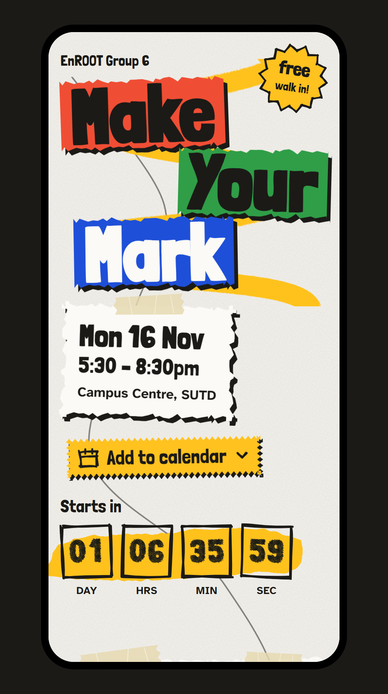
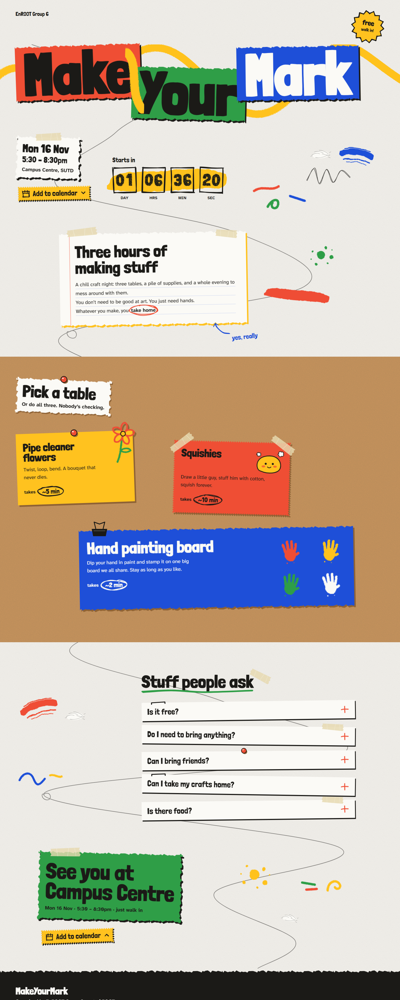

# MakeYourMark

**A one-page event site for MakeYourMark, a free walk-in craft night at SUTD.**
Mon 16 Nov 2026 · 5:30–8:30pm SGT · Campus Centre. By EnROOT Group 6, part of ROOT.

### 🔗 Live site: [makeyourmark-iota.vercel.app](https://makeyourmark-iota.vercel.app/)

> 📱 **Optimised for mobile.** Best viewed on a phone, or with your browser's mobile view.

People reach the site by scanning a QR code on a campus poster, almost always on their phones while walking past. The goal is that they can read it in under 30 seconds and know when, where, what's on, and that they can just show up.

<p align="center">
  
</p>

<details>
<summary><b>Full desktop page</b></summary>
<br>

</details>

## Features

- **Hand-made look, built in code.** Torn paper, tape, pins, a corkboard and sketchy lines are SVG, not images. The sketchy lines come from [Rough.js](https://roughjs.com) with fixed seeds, so they render on the server and look the same on every load.
- **Title that draws itself.** "Make Your Mark" is drawn stroke by stroke from the font's real glyph outlines, which are pre-extracted to `lib/title-glyphs.ts`.
- **Live countdown.** Shows "Starts in" before the event, "Happening now" while it runs, then a thank-you note afterwards.
- **Add to calendar.** One button for Google Calendar or a downloadable `.ics` file (Apple Calendar, Outlook). The `.ics` follows RFC 5545 and is generated at build time from the same event times the countdown uses.
- **Optimised for mobile.** Designed for a 390px phone screen first, then scaled up to desktop.
- **Accessible.** A Radix accordion for the FAQ (works with a keyboard and screen readers), a legible body font (Atkinson Hyperlegible), and all motion turned off for people who set `prefers-reduced-motion`.
- **Fully static.** Every route is prerendered and fonts are self-hosted, so there are no runtime requests to Google.

## Tech stack

| | |
| --- | --- |
| Framework | [Next.js 16](https://nextjs.org) (App Router) + React 19 + TypeScript |
| Styling | Tailwind CSS v4 (design tokens in `app/globals.css`) |
| Motion | [Motion](https://motion.dev) |
| UI | [Radix Accordion](https://www.radix-ui.com/primitives/docs/components/accordion) |
| Drawing | [Rough.js](https://roughjs.com) |
| Hosting | Vercel |

## Run it locally

```bash
npm install
npm run dev     # http://localhost:3000
npm run build   # production build (fully static)
```

To deploy, import the repo on Vercel. No settings needed.

## Project structure

```
app/
  page.tsx                  the page: assembles the sections
  layout.tsx                fonts, metadata
  globals.css               colours, fonts, tilts, shadows, motion
  makeyourmark.ics/route.ts static .ics calendar file
components/
  sections/                 hero, about, stations, questions, venue, footer
  countdown.tsx             live countdown with phase switching
  add-to-calendar.tsx       Google / .ics menu
  rough.tsx, doodles.tsx    sketchy lines and hand-drawn doodles
lib/
  content.ts                all copy: stations, FAQ, links
  event.ts                  event start/end (SGT)
  calendar.ts               .ics + Google Calendar URL builder
  title-glyphs.ts           pre-extracted title outlines
public/paper/               paper, cork and torn-edge textures
qr/                         QR code for the poster (PNG + SVG)
```

## Editing content

| What | File |
| --- | --- |
| Copy, stations, FAQ, Instagram link | `lib/content.ts` |
| Event start/end (drives countdown + calendar) | `lib/event.ts` |
| Colours, fonts, tilts, shadows, motion curve | `app/globals.css` (`@theme`) |

The footer's Instagram link stays hidden until `INSTAGRAM_URL` in `lib/content.ts` is set to a real account.

## Credits

Made by EnROOT Group 6 for ROOT, SUTD. Site by Thejas.
